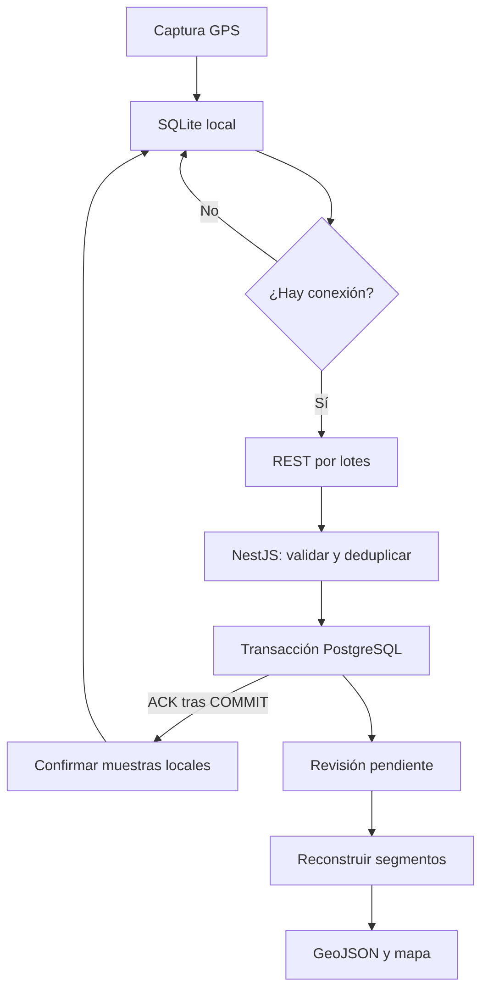

# Plan de arquitectura: módulo de rastreo de rutas

**Integración:** sistema existente de control de asistencia.  
**Stack:** NestJS, PostgreSQL y PostGIS.  
**Concurrencia prevista:** hasta 50 pilotos con viajes activos.  
**Estado:** propuesta técnica para implementar y validar en campo.

## 1. Objetivo y decisión principal

Registrar los recorridos de pilotos que transportan materia prima hacia distintas obras, desde que presionan **Iniciar** hasta que presionan **Finalizar**, y permitir consultar el trayecto en un mapa.

Se recomienda una arquitectura sencilla: **captura GPS adaptativa en la app, almacenamiento local persistente, envío HTTPS mediante REST por lotes y escritura masiva transaccional en PostgreSQL**. NestJS se integra como un módulo del backend actual y reutiliza sus usuarios, obras, permisos y autenticación.

No se necesita incorporar Redis, un broker ni microservicios para el volumen inicial. El servidor confirma un lote únicamente después de que PostgreSQL lo haya guardado. Los trabajos de reconstrucción de rutas pueden procesarse por separado y recuperarse desde un estado pendiente persistido en la misma base de datos.

### Alcance real de la precisión

Un teléfono permite obtener una **aproximación de alta fidelidad**, pero no garantiza una ruta exacta en todo momento: túneles, edificios, permisos, batería y restricciones del sistema operativo pueden interrumpir o degradar las mediciones. El sistema debe conservar la precisión reportada por el dispositivo y mostrar discontinuidades. No debe presentar como medido un camino que fue interpolado o ajustado a una carretera.

Los intervalos y umbrales propuestos son parámetros iniciales de ingeniería; deben calibrarse con los teléfonos y recorridos reales. No son garantías de frecuencia del sistema operativo ni recomendaciones textuales de los fabricantes.

## 2. Captura GPS y frecuencia de transmisión

### 2.1 Separar captura, conservación y envío

Son tres operaciones diferentes:

1. **Capturar:** solicitar ubicaciones al servicio nativo del teléfono.
2. **Conservar:** decidir cuáles se guardan en la cola local como muestras del viaje.
3. **Enviar:** agrupar esas muestras en solicitudes al backend.

Enviar cada 30 segundos no implica medir cada 30 segundos. Las muestras intermedias permanecen en el teléfono y viajan juntas. Reducir solicitudes de red disminuye su sobrecarga, pero el consumo del GPS se controla ajustando también la captura.

### 2.2 Política inicial recomendada

| Situación | Captura solicitada | Conservación local | Envío al backend |
|---|---|---|---|
| Inicio | Solicitar una ubicación reciente con buena precisión | Guardar primer punto disponible e indicar su calidad | Enviar inicio y primer lote cuando haya conexión |
| Vehículo en movimiento | Aproximadamente cada 2 segundos | Guardar cuando se cumpla cualquiera de los criterios siguientes | Cada 30 segundos o al acumular 50 puntos, lo que ocurra primero |
| Curvas o cambios frecuentes de dirección | Mantener captura de 1–2 segundos cuando el dispositivo lo permita | Conservar muestras adicionales de la curva | Incluirlas en el siguiente lote |
| Detenido durante al menos 60 segundos | Reducir a 15–30 segundos; usar detección nativa de movimiento si está disponible | Una muestra de control cada 60 segundos; evitar puntos por deriva GPS | Enviar si hay pendientes; sin solicitudes vacías |
| Reanudación del movimiento | Volver inmediatamente al perfil de movimiento al detectarlo | Guardar un punto de reanudación | Política normal |
| Finalización | Intentar obtener última ubicación reciente, sin bloquear indefinidamente | Guardar punto final si existe y evento de cierre | Vaciar pendientes y sincronizar cierre |

**Criterios de conservación durante el movimiento, unidos por OR:**

- Han transcurrido **5 segundos** desde el último punto conservado.
- Se ha avanzado **20 metros** desde el último punto conservado.
- Cambió el rumbo al menos **15°**, con desplazamiento suficiente para distinguir movimiento de ruido y velocidad aproximada superior a 5 km/h.

El cambio angular se calcula con diferencia circular mínima: pasar de 359° a 1° equivale a 2°. Comparar el rumbo con el último punto conservado y descartar rumbo desconocido o inestable. Como filtro inicial, exigir un desplazamiento de al menos `max(10 m, precisión reportada)` para activar exclusivamente el criterio angular.

Estas reglas se evalúan al recibir una muestra: no aseguran exactamente 20 metros entre puntos. A 90 km/h se recorren aproximadamente 50 metros en 2 segundos. Si las pruebas muestran curvas insuficientemente representadas, usar captura de 1 segundo durante movimiento; no basta con aumentar la frecuencia de envío.

Para detectar reanudación desde reposo, usar señales nativas de movimiento cuando estén disponibles; si solo hay sondeo cada 15–30 segundos, documentar ese posible retraso de detección y ajustar el perfil cuando sea relevante.

### 2.3 Calidad de las coordenadas

Cada muestra incluye hora de captura, precisión horizontal en metros, velocidad y rumbo si están disponibles.

- **Hasta 25 m:** candidata a dibujo normal, sujeta a comprobaciones adicionales.
- **Entre 25 y 50 m:** conservar con marca de baja precisión.
- **Más de 50 m:** conservar como evidencia degradada; excluir por defecto del trazo confiable.
- Coordenadas fuera de rango o valores numéricos no finitos: rechazar por error de formato.
- Saltos de posición: marcar para revisión considerando distancia, tiempo, precisión y velocidad plausible. No imponer un límite universal sin validar las condiciones de operación.

No se borran las muestras válidas estructuralmente solo por ser imprecisas. La evaluación de calidad definitiva se realiza con sus vecinos ordenados, porque los lotes pueden llegar fuera de orden.

No reutilizar silenciosamente una ubicación antigua como punto final. Si no hay señal GPS, registrar el cierre sin coordenada y mostrar que la ubicación final no estuvo disponible.

### 2.4 Ejecución móvil y batería

En Android, iniciar desde la acción visible del piloto un **foreground service de tipo `location`**, con notificación y permisos correspondientes a la versión objetivo. En iOS, configurar Core Location y la capacidad de ubicación en segundo plano con la autorización que requiera el flujo elegido. Las restricciones exactas deben verificarse contra las versiones soportadas [1][2].

Una página web abierta en el navegador no es una base confiable para garantizar captura continua con pantalla bloqueada. La app debe contar con integración nativa, aunque su interfaz se construya con una tecnología híbrida.

Detener la captura al finalizar o cancelar. No mantener GPS de alta precisión fuera de un viaje. Validar pantalla bloqueada, ahorro de energía, reinicio, revocación de permisos y cierre forzado. Si el sistema operativo interrumpe la captura, registrar y mostrar el hueco; no prometer recuperación de posiciones que nunca se midieron.

## 3. Estrategia de ingesta en NestJS

### 3.1 REST por lotes como opción inicial

La app envía `POST /viajes/:id/puntos/lote` con un arreglo de puntos. Durante operación normal los lotes serán pequeños; para sincronización histórica se permiten hasta **200 puntos** y un límite adicional inicial de **256 KiB por solicitud**.

La API valida el lote completo y realiza una transacción breve:

1. Verifica usuario, empresa, pertenencia del viaje y dispositivo asignado.
2. Bloquea la fila del viaje con `SELECT ... FOR UPDATE` para coordinar ingesta y cierre.
3. Valida estado, secuencias y duplicados.
4. Inserta todos los puntos nuevos mediante una sola sentencia parametrizada `INSERT ... SELECT` o `INSERT ... VALUES` con varias filas.
5. Actualiza una vez el contador de puntos, última secuencia recibida y revisión de la ruta.
6. Hace `COMMIT` y devuelve la confirmación.

Se conserva una fila por muestra porque permite ordenar, auditar y filtrar. La optimización consiste en **una sentencia masiva por lote**, evitando un viaje de red y una transacción por coordenada. No debe usarse un bucle con `await repository.save(punto)`.

PostgreSQL soporta inserción de varias filas y manejo de conflictos mediante `ON CONFLICT` [3]. El detalle de implementación propuesto aquí añade las reglas de integridad del módulo.

### 3.2 Idempotencia y confirmaciones

La app genera un UUID de viaje y asigna una secuencia incremental a cada muestra conservada: `1, 2, 3...`. La secuencia se asigna junto con la escritura local en una transacción, para evitar saltos provocados por un cierre inesperado.

La clave primaria de puntos será `(viaje_id, secuencia)`. El backend recibe entregas **al menos una vez**, pero la unicidad evita filas repetidas.

- Un reenvío con la misma clave y el mismo contenido se confirma como duplicado válido.
- La misma clave con otro contenido devuelve `409 Conflict`; no debe sobrescribirse ni descartarse silenciosamente.
- Para comprobar igualdad, comparar los campos normalizados del registro original; la calidad derivada por el servidor no forma parte de esa comparación.
- Un `batchId` sirve para trazabilidad, pero no sustituye la unicidad de cada punto.
- El ACK identifica las secuencias del lote ya persistidas, incluidas las duplicadas idénticas. La app elimina de pendientes solo esas muestras.
- No usar la mayor secuencia recibida como confirmación de que todas las anteriores existen.

Ante un timeout después del `COMMIT`, el cliente reenvía el mismo lote. Ante un error previo al `COMMIT`, conserva el lote para reintentarlo. No confirmar solo porque los datos llegaron a la memoria del proceso.

### 3.3 Conectividad intermitente

Usar **SQLite local como bandeja de salida persistente**, con los eventos de inicio/cierre, puntos y estado de sincronización. Almacenar primero y enviar después, tanto con conexión como sin ella.

- Sin internet, continuar capturando y guardando. Perder red no equivale a perder GPS.
- Al recuperar red, sincronizar el inicio y después los puntos pendientes por secuencia.
- Permitir una solicitud de lote en vuelo por dispositivo como política inicial.
- Aplicar reintentos con espera exponencial y variación aleatoria, por ejemplo 2, 4, 8, 16 y hasta 60 segundos; reiniciar la espera cuando se recupere conectividad.
- Respetar `Retry-After` en respuestas `429` o `503`.
- Ante `401`, renovar sesión antes de continuar; ante `403`, `409` o validación fallida, detener el reintento automático de ese lote y mostrar una acción de resolución.
- Conservar los originales de un lote inválido; permitir corregir su formato o resolverlo de forma auditada. No saltar secuencias para aparentar una sincronización completa.
- Mostrar cantidad pendiente, última sincronización, disponibilidad de GPS y espacio local bajo.

Dimensionar la cola para al menos 24 horas sin conexión. A un punto cada 2 segundos serían 43,200 muestras por dispositivo. El consumo real depende del esquema SQLite; medirlo. Nunca descartar pendientes sin avisar para liberar espacio.

El inicio sin conexión puede permitirse con sesión previamente válida y catálogo local de obras. Al sincronizar, el backend vuelve a validar permisos y referencias. Si existe un conflicto de negocio, conservar el viaje local y enviarlo a resolución; no perder la evidencia.

### 3.4 Por qué no usar WebSockets o Redis inicialmente

| Alternativa | Uso recomendado | Motivo |
|---|---|---|
| REST con lotes | Ingesta principal | Facilita reintentos, límites, autenticación y confirmaciones durables |
| WebSockets o SSE | Opcional para actualizar el mapa del supervisor | La conexión persistente no resuelve por sí sola la pérdida de red ni la durabilidad |
| Redis + BullMQ | Opcional para trabajos pesados al crecer | Añade operación y una dependencia; no es necesario para la ingesta prevista |
| `COPY` a tabla temporal y consolidación | Importaciones grandes futuras | Útil para grandes volúmenes; excesivo para lotes de hasta 200 puntos |

NestJS dispone de integración con BullMQ, que utiliza Redis [4]. Si se incorpora, conviene empezar por reconstrucciones, exportaciones o ajuste a carreteras. Para coordinar escritura en PostgreSQL y publicación de trabajos, usar una bandeja de eventos transaccional o un escaneo recuperable de revisiones pendientes.

Un panel que tolere 30–60 segundos de desfase puede consultar periódicamente la última ubicación. Si se requiere menos de 10 segundos, reducir el intervalo de transmisión a 5–10 segundos y medir consumo. WebSockets no harán más recientes datos que todavía no se enviaron.

## 4. Modelado de datos en PostgreSQL y PostGIS

### 4.1 Tablas propuestas

| Tabla | Responsabilidad |
|---|---|
| `tracking.viajes` | Piloto, empresa, obra, dispositivo, tiempos y estado de sincronización |
| `tracking.puntos_viaje` | Muestras originales, secuencia y metadatos de calidad |
| `tracking.segmentos_viaje` | Líneas derivadas para dibujar tramos continuos y calcular distancia observada |

Los usuarios y obras pertenecen al sistema actual. No duplicar sus catálogos ni guardar puntos GPS en la tabla de marcaciones de asistencia. Si el negocio relaciona viaje y jornada, incorporar una referencia opcional a esa jornada sin convertir cada muestra en una marcación.

### 4.2 Geometry frente a Geography

Guardar puntos como **`geometry(Point, 4326)`** y segmentos como **`geometry(LineString, 4326)`**. WGS84 facilita intercambio con GPS y GeoJSON. El orden es **longitud, latitud**.

Para obtener metros, convertir la geometría a `geography`: `ST_Length(geom::geography)`. Una longitud calculada directamente sobre `geometry` con SRID 4326 está expresada en unidades angulares, no en metros [5]. No duplicar cada muestra en columnas `geometry` y `geography` inicialmente.

### 4.3 Esquema SQL de referencia

Los UUID externos de este ejemplo son supuestos. Antes de ejecutar la migración, adaptar sus tipos y agregar claves foráneas hacia las tablas reales de empresa, usuario, obra y dispositivo. En un sistema multiempresa, esas relaciones deben impedir referencias cruzadas entre empresas, mediante claves compuestas o validación equivalente dentro de la transacción.

```sql
CREATE EXTENSION IF NOT EXISTS postgis;
CREATE SCHEMA IF NOT EXISTS tracking;

CREATE TABLE tracking.viajes (
    id uuid PRIMARY KEY, -- generado en la app; permite inicio sin conexión
    empresa_id uuid NOT NULL,
    piloto_id uuid NOT NULL,
    obra_destino_id uuid NOT NULL,
    dispositivo_id uuid NOT NULL,
    vehiculo_id uuid,
    estado text NOT NULL DEFAULT 'EN_CURSO'
        CHECK (estado IN (
            'EN_CURSO', 'SINCRONIZANDO', 'FINALIZADO',
            'INCOMPLETO', 'CANCELADO'
        )),
    inicio_dispositivo timestamptz NOT NULL,
    fin_dispositivo timestamptz,
    creado_servidor timestamptz NOT NULL DEFAULT now(),
    cierre_recibido_servidor timestamptz,
    ultima_recepcion_servidor timestamptz,
    secuencia_final_esperada bigint
        CHECK (secuencia_final_esperada >= 0),
    cantidad_puntos bigint NOT NULL DEFAULT 0
        CHECK (cantidad_puntos >= 0),
    ultima_secuencia_recibida bigint NOT NULL DEFAULT 0
        CHECK (ultima_secuencia_recibida >= 0),
    revision_datos bigint NOT NULL DEFAULT 0,
    revision_ruta bigint NOT NULL DEFAULT 0,
    distancia_observada_m double precision
        CHECK (distancia_observada_m >= 0),
    duracion_monotonica_ms bigint
        CHECK (duracion_monotonica_ms >= 0),
    observaciones text,
    CHECK (revision_ruta >= 0 AND revision_ruta <= revision_datos)
);

CREATE TABLE tracking.puntos_viaje (
    viaje_id uuid NOT NULL REFERENCES tracking.viajes(id),
    secuencia bigint NOT NULL CHECK (secuencia > 0),
    capturado_en timestamptz NOT NULL,
    recibido_en timestamptz NOT NULL DEFAULT now(),
    geom geometry(Point, 4326) NOT NULL,
    precision_m real NOT NULL CHECK (precision_m >= 0),
    velocidad_mps real CHECK (velocidad_mps >= 0),
    rumbo_grados real CHECK (rumbo_grados >= 0 AND rumbo_grados < 360),
    altitud_m real,
    sesion_captura_id uuid NOT NULL,
    tiempo_monotonico_ms bigint CHECK (tiempo_monotonico_ms >= 0),
    segmento_local integer NOT NULL DEFAULT 1 CHECK (segmento_local > 0),
    calidad text NOT NULL DEFAULT 'PENDIENTE'
        CHECK (calidad IN ('PENDIENTE', 'VALIDO', 'BAJA_PRECISION', 'SOSPECHOSO')),
    motivo_calidad text,
    PRIMARY KEY (viaje_id, secuencia),
    CHECK (NOT ST_IsEmpty(geom)),
    CHECK (ST_X(geom) BETWEEN -180 AND 180),
    CHECK (ST_Y(geom) BETWEEN -90 AND 90)
);

CREATE TABLE tracking.segmentos_viaje (
    viaje_id uuid NOT NULL REFERENCES tracking.viajes(id),
    numero integer NOT NULL CHECK (numero > 0),
    secuencia_desde bigint NOT NULL,
    secuencia_hasta bigint NOT NULL,
    geom geometry(LineString, 4326) NOT NULL,
    distancia_m double precision NOT NULL CHECK (distancia_m >= 0),
    revision_origen bigint NOT NULL,
    PRIMARY KEY (viaje_id, numero),
    CHECK (secuencia_hasta > secuencia_desde),
    CHECK (ST_NPoints(geom) >= 2)
);

CREATE INDEX ix_viajes_piloto_fecha
    ON tracking.viajes (empresa_id, piloto_id, inicio_dispositivo DESC);

CREATE INDEX ix_viajes_obra_fecha
    ON tracking.viajes (empresa_id, obra_destino_id, inicio_dispositivo DESC);

CREATE INDEX ix_viajes_pendientes
    ON tracking.viajes (ultima_recepcion_servidor)
    WHERE revision_ruta < revision_datos;

-- Aplicar si la regla de negocio permite solo un viaje en curso por piloto.
-- SINCRONIZANDO no bloquea empezar el siguiente viaje.
CREATE UNIQUE INDEX ux_viaje_en_curso_piloto
    ON tracking.viajes (empresa_id, piloto_id)
    WHERE estado = 'EN_CURSO';

-- Opcional: crear cuando existan consultas espaciales por zona o cercanía.
-- CREATE INDEX ix_puntos_geom
--     ON tracking.puntos_viaje USING gist (geom);
-- CREATE INDEX ix_segmentos_geom
--     ON tracking.segmentos_viaje USING gist (geom);
```

La clave primaria de puntos ya crea un índice B-tree útil para obtener un viaje ordenado por secuencia. No agregar otro índice idéntico. GiST se justifica cuando se consulta por posición; no acelera por sí mismo `WHERE viaje_id = ...`.

Para una consulta frecuente con `ST_DWithin(geom::geography, ..., metros)`, considerar un índice GiST sobre la misma expresión `geom::geography`; el índice de `geometry` no sustituye automáticamente ese índice.

`capturado_en` representa la hora del dispositivo y `recibido_en` la del servidor. La secuencia determina el orden del trayecto. El reloj del teléfono puede cambiar: usar tiempo monotónico dentro de una sesión de captura para duración y detección de saltos, y registrar una nueva sesión tras reiniciar. No calcular intervalos monotónicos entre sesiones distintas.

### 4.4 Ejemplo de inserción masiva

La consulta recibe `$1 = viaje_id` y `$2 = arreglo JSON de puntos`. Se ejecuta después de validar el lote, bloquear el viaje y comprobar que las claves existentes tienen contenido idéntico.

```sql
INSERT INTO tracking.puntos_viaje (
    viaje_id, secuencia, capturado_en, geom,
    precision_m, velocidad_mps, rumbo_grados,
    altitud_m, sesion_captura_id, tiempo_monotonico_ms,
    segmento_local
)
SELECT
    $1::uuid,
    p.secuencia,
    p.capturado_en,
    ST_SetSRID(ST_MakePoint(p.longitud, p.latitud), 4326),
    p.precision_m,
    p.velocidad_mps,
    p.rumbo_grados,
    p.altitud_m,
    p.sesion_captura_id,
    p.tiempo_monotonico_ms,
    p.segmento_local
FROM jsonb_to_recordset($2::jsonb) AS p (
    secuencia bigint,
    capturado_en timestamptz,
    longitud double precision,
    latitud double precision,
    precision_m real,
    velocidad_mps real,
    rumbo_grados real,
    altitud_m real,
    sesion_captura_id uuid,
    tiempo_monotonico_ms bigint,
    segmento_local integer
)
ON CONFLICT (viaje_id, secuencia) DO NOTHING
RETURNING secuencia;
```

`RETURNING` entrega solo filas nuevas. Sumar su cantidad al contador del viaje; no sumar el tamaño completo del lote. Para el ACK, combinar esas secuencias con las duplicadas cuya igualdad ya fue verificada. Rechazar claves repetidas con contenido distinto también dentro de un mismo lote.

Esta sentencia ilustra la escritura masiva; no sustituye la transacción de autorización, comparación de duplicados, control de estado y actualización del viaje. En NestJS puede ejecutarse con el administrador transaccional del ORM existente o mediante `pg`, siempre con parámetros [3][6].

## 5. Cierre confiable del viaje

Pulsar **Finalizar** debe detener inmediatamente la captura y guardar localmente un evento con hora de finalización y `secuenciaFinalEsperada = N`, aunque no haya internet. `N` es la última secuencia asignada, no la última confirmada por el servidor.

Estados del servidor:

- **EN_CURSO:** viaje iniciado, sin cierre recibido.
- **SINCRONIZANDO:** cierre recibido, pero todavía faltan puntos entre 1 y N.
- **FINALIZADO:** cierre recibido y todos los puntos esperados están persistidos.
- **INCOMPLETO:** hay una interrupción o pérdida que no puede resolverse automáticamente; requiere revisión.
- **CANCELADO:** cancelación explícita y auditada.

La finalización del negocio y la sincronización de la evidencia son cosas distintas: la app puede mostrar “Viaje terminado; quedan puntos por sincronizar”.

### Reglas para evitar cierres prematuros

1. Procesar cierre e ingesta bajo el mismo bloqueo de fila del viaje.
2. Persistir una sola declaración de cierre; repeticiones idénticas son idempotentes y cambios incompatibles devuelven `409`.
3. Rechazar un cierre cuyo N sea menor que una secuencia ya almacenada.
4. Después de recibir el cierre, aceptar únicamente puntos de ese viaje con secuencia entre 1 y N.
5. Finalizar cuando existan todas las secuencias de 1 a N. Con unicidad, secuencias positivas y prohibición de valores mayores que N, `cantidad_puntos = N` demuestra completitud. También puede consultarse la lista de rangos faltantes.
6. Una vez finalizado, confirmar duplicados idénticos; no admitir puntos nuevos ni modificaciones sin un procedimiento explícito de corrección.
7. N = 0 puede representar un viaje sin posiciones capturadas: cerrar, pero señalar “sin evidencia GPS”; completitud de envío no implica calidad de ruta.

Un cierre puede llegar antes que algunos lotes sin perderlos: el viaje permanece en `SINCRONIZANDO`. Un viaje `INCOMPLETO` puede recibir recuperación autorizada de puntos dentro del rango declarado y volver a evaluarse.

Si el piloto empieza otro viaje estando sin conexión, sincronizar primero la declaración de cierre del anterior para liberar la restricción de un viaje en curso. Las muestras del anterior pueden seguir llegando mientras está en `SINCRONIZANDO`.

## 6. Construcción y visualización de la ruta

Los puntos originales son la fuente de verdad. Los segmentos son una representación derivada que puede reconstruirse.

### 6.1 Construcción de segmentos

1. Leer los puntos del viaje ordenados por `secuencia`, nunca por orden de llegada.
2. Evaluar calidad y dividir en segmentos cuando exista pérdida de GPS, reinicio de captura, secuencias ausentes o un salto incompatible con movimiento real.
3. Usar inicialmente un hueco superior a 30 segundos durante movimiento como señal para revisar una discontinuidad; no aplicar esa regla sin considerar el perfil de reposo de 60 segundos.
4. Si se excluye un punto sospechoso, evaluar también el enlace entre sus vecinos: no unirlos automáticamente.
5. Crear una línea por grupo continuo con al menos dos puntos, usando `ST_MakeLine(geom ORDER BY secuencia)` [7].
6. Mostrar puntos aislados como marcadores; no fabricar una línea a partir de una sola coordenada.
7. Sumar `ST_Length(linea::geography)` de los segmentos aceptados para obtener la **distancia observada**. No sumar distancias a través de los huecos.

`segmento_local` ayuda a indicar interrupciones detectadas por la app, pero el servidor valida y puede subdividir más. Una pérdida exclusiva de internet no obliga a cortar la ruta si la captura GPS local continuó.

### 6.2 Trabajo recuperable y consistencia

Incrementar `revision_datos` cuando llegan puntos nuevos y cuando se declara el cierre. Un trabajador interno consulta viajes con `revision_ruta < revision_datos`; puede ejecutarse cada 30–60 segundos y al detectar un cierre.

Para construir una revisión:

1. Leer los puntos y su revisión con una instantánea consistente.
2. Calcular los segmentos fuera de la transacción de ingesta.
3. En una transacción corta, bloquear el viaje y comprobar que `revision_datos` sigue siendo la leída.
4. Si coincide, reemplazar los segmentos, actualizar distancia y establecer `revision_ruta`.
5. Si cambió, descartar el resultado y reintentar posteriormente.

Un reinicio no pierde trabajo porque la diferencia de revisiones permanece en PostgreSQL. Para varias instancias, reclamar trabajos mediante bloqueo o lease persistente; no depender únicamente de un cron en memoria. El estado `FINALIZADO` indica completitud de sincronización; la API debe informar por separado si la ruta derivada todavía está procesándose.

### 6.3 Entrega al mapa

Devolver GeoJSON como `FeatureCollection` con una `LineString` por segmento y marcadores de inicio/final cuando existan. Incluir precisión, huecos, puntos descartados y revisión utilizada. Para viajes activos, consultar solo puntos posteriores a la última secuencia mostrada o reconstruir únicamente lo necesario.

Para recorridos extensos, servir una representación simplificada según el zoom y mantener disponibles los originales. Si la tolerancia está expresada en metros, simplificar en un sistema de coordenadas proyectado apropiado; no aplicar directamente esa tolerancia sobre grados de EPSG:4326.

El ajuste a carreteras o **map matching** es una mejora opcional. Puede seleccionar la carretera equivocada en vías paralelas o accesos internos a obras. Guardar esa ruta separada, indicando que es estimada y sin reemplazar las coordenadas medidas.

## 7. Contrato inicial de API

| Método y ruta | Propósito |
|---|---|
| `POST /viajes` | Crear o confirmar un viaje usando el UUID generado por la app |
| `POST /viajes/:id/puntos/lote` | Persistir entre 1 y 200 puntos de forma idempotente |
| `POST /viajes/:id/finalizar` | Declarar hora final y última secuencia esperada |
| `GET /viajes/:id/sincronizacion` | Consultar estado, cantidad persistida y rangos faltantes |
| `GET /viajes/:id/ruta` | Obtener segmentos GeoJSON, métricas y calidad |
| `GET /viajes/:id/puntos?despuesDe=...&limite=...` | Recuperar puntos ordenados y paginados |

Ejemplo de lote:

```json
{
  "batchId": "4f0b5632-37c1-4b15-90d4-711741344247",
  "puntos": [
    {
      "secuencia": 1,
      "capturado_en": "2026-10-04T14:00:00Z",
      "latitud": 14.6349,
      "longitud": -90.5069,
      "precision_m": 8.5,
      "velocidad_mps": 11.2,
      "rumbo_grados": 75,
      "altitud_m": null,
      "sesion_captura_id": "e69d2058-97f7-4efa-b12e-c1084945142b",
      "tiempo_monotonico_ms": 12000,
      "segmento_local": 1
    }
  ]
}
```

Ejemplo de confirmación posterior al `COMMIT`:

```json
{
  "batchId": "4f0b5632-37c1-4b15-90d4-711741344247",
  "secuenciasConfirmadas": [1],
  "insertados": 1,
  "duplicados": 0
}
```

La identidad del piloto y de la empresa se obtiene de la sesión y las relaciones autorizadas; no se confía en valores enviados libremente por el cliente. Las fechas de ejemplo están en UTC; convertir a la zona del usuario solo para presentación.

## 8. Organización en NestJS e integración

Implementar un `TrackingModule` dentro del backend existente, con estas responsabilidades:

| Componente | Responsabilidad |
|---|---|
| `ViajesController` | Inicio, cierre y consulta del viaje |
| `PuntosController` | Recepción y validación de lotes |
| `ViajesService` | Reglas de negocio y transiciones de estado |
| `IngestaService` | Idempotencia, transacciones e inserción masiva |
| `RutasService` | Segmentación, calidad, distancia y GeoJSON |
| `RutasWorker` | Reconstrucción recuperable de revisiones pendientes |
| Repositorios | Consultas parametrizadas y acceso a PostGIS |

Reutilizar el ORM, autenticación y estructura modular que ya tenga el sistema. Exponer las operaciones mediante DTO con validación de arreglos, límites, fechas y números finitos.

Si asistencia necesita recibir un evento `ViajeFinalizado`, registrar un evento pendiente en la misma transacción que finaliza el viaje y procesarlo con idempotencia. No asumir que actualizar la asistencia y publicar un mensaje externo son una operación atómica.

## 9. Flujo completo

1. El piloto selecciona obra y presiona **Iniciar**.
2. La app comprueba permisos, crea el UUID y guarda el inicio localmente.
3. Activa captura nativa, conserva muestras con secuencias persistentes y solicita creación del viaje cuando hay conexión.
4. Cada 30 segundos o 50 muestras, envía un lote; durante recuperación permite hasta 200.
5. NestJS autentica, valida, controla duplicados y guarda mediante una transacción masiva.
6. PostgreSQL confirma; NestJS envía el ACK y la app retira esas secuencias de pendientes.
7. Si falla la red, la cola sigue creciendo localmente. Al volver, reenvía con las mismas claves.
8. El trabajador reconstruye segmentos pendientes y el mapa consulta la revisión disponible.
9. Al presionar **Finalizar**, la app detiene el GPS y guarda el cierre con N.
10. El backend registra el cierre y espera las secuencias faltantes; cuando tiene 1..N, finaliza la sincronización.
11. Se reconstruye la última revisión y se muestran recorrido, distancia observada, duración y discontinuidades.



## 10. Capacidad y crecimiento

Estimaciones para 50 pilotos, todos en movimiento durante 8 horas, sin afirmar rendimiento medido:

| Escenario | Puntos/segundo totales | Puntos en 8 horas |
|---|---:|---:|
| Un punto conservado cada 5 s | 10 | 288,000 |
| Un punto conservado cada 2 s | 25 | 720,000 |
| Perfil denso de 1 s | 50 | 1,440,000 |

Con envío cada 30 segundos, hay aproximadamente **1.67 solicitudes de lotes por segundo** para 50 dispositivos, salvo envíos adelantados por tamaño, reintentos o recuperación. A una muestra cada 2 segundos, cada lote normal contiene unas 15 muestras.

La carga es moderada para una instalación adecuadamente dimensionada de PostgreSQL, pero el historial sí crece: 720,000 puntos diarios equivalen a unos 21.6 millones en 30 días de operación continua bajo ese supuesto. Medir el tamaño real con `pg_total_relation_size`, incluyendo índices, antes de fijar capacidad y retención.

No particionar por piloto. Empezar sin particiones si la retención y el almacenamiento lo permiten. Si el historial requiere partición temporal, diseñarla junto con la clave de unicidad: en PostgreSQL las restricciones únicas de tablas particionadas deben incluir las columnas de partición. Agregar una fecha a la partición sin adaptar la clave `(viaje_id, secuencia)` puede romper la estrategia de deduplicación.

Configurar un pool acotado según la base existente; como punto de partida sujeto a prueba, 5–10 conexiones para esta aplicación pueden ser suficientes. No reservar una conexión por piloto. Limitar recuperaciones, introducir variación en el envío y aplicar contrapresión para evitar una ráfaga cuando todos recuperen internet simultáneamente.

## 11. Seguridad, operación y validación

### Controles de operación

- HTTPS y autenticación existente; autorización por viaje, piloto, empresa y obra.
- Solo el piloto/dispositivo asignado puede aportar muestras; el supervisor consulta según sus permisos.
- Seguimiento visible y limitado al viaje; evitar incluir coordenadas completas en logs generales.
- Definir retención de originales y resúmenes según la necesidad del negocio antes de producción.
- Backups y prueba de restauración de PostgreSQL/PostGIS; no usar tablas `UNLOGGED` para evidencia del recorrido.
- Medir latencia de ingesta, puntos nuevos/duplicados, errores, retraso entre captura y recepción, viajes pendientes y duración de reconstrucción.

### Pruebas de aceptación propuestas

| Prueba | Resultado esperado |
|---|---|
| Recorrido real con rectas, curvas y detenciones | Trazado útil, calidad visible y consumo de batería medido |
| Una hora sin internet | Todas las muestras conservadas se sincronizan sin duplicación |
| Timeout después de guardar el lote | Reenvío confirmado sin crear nuevas filas |
| Reinicio del backend durante ingesta | Sin ACK falso; reintento recupera la operación |
| Cierre recibido antes del último lote | Estado `SINCRONIZANDO` hasta completar 1..N |
| Secuencias 1, 2 y 4 recibidas con N = 4 | No finalizar mientras falte 3 |
| Misma secuencia con otra coordenada | Conflicto explícito; original conservado |
| Túnel o GPS desactivado | Hueco visible, sin línea presentada como medición real |
| Pantalla bloqueada y ahorro de energía | Comportamiento validado en cada familia de dispositivos soportada |
| 50 pilotos y recuperación simultánea de pendientes | Latencia y cola controladas; ninguna pérdida de muestras confirmadas |
| Consulta desde otra empresa | Acceso denegado |
| Reinicio del trabajador de rutas | Revisión pendiente procesada posteriormente |

Como objetivo inicial de carga, proponer un p95 inferior a 500 ms para lotes normales en condiciones de prueba definidas, excluyendo la red móvil. Este valor es un objetivo a verificar, no un resultado obtenido. El consumo de batería y la fidelidad del trazo deben evaluarse en recorridos representativos de varias horas.

## 12. Orden recomendado de implementación

1. **Base de datos y contratos:** migraciones, relaciones reales, permisos, estados y DTO.
2. **Captura móvil:** servicio nativo, SQLite, secuencias y eventos persistentes.
3. **Ingesta confiable:** lotes, transacciones, duplicados y recuperación sin conexión.
4. **Finalización:** rango esperado, faltantes y cierre idempotente.
5. **Mapa:** evaluación de calidad, segmentos, métricas y actualización incremental.
6. **Validación en campo:** ajustar frecuencia, batería, precisión y restricciones del sistema operativo.
7. **Operación:** métricas, retención, respaldos y evaluación de crecimiento.

La prioridad es asegurar que ninguna muestra confirmada se pierda y que el mapa refleje lo que realmente se observó. Para 50 pilotos, REST por lotes y PostgreSQL/PostGIS ofrecen un punto de partida suficiente y mantenible; las dependencias adicionales se incorporan cuando las métricas o los requisitos de producto las justifiquen.

## 13. Documentación oficial de referencia

Los enlaces respaldan las capacidades de plataforma y las funciones utilizadas. La arquitectura, los umbrales y los objetivos de prueba son propuestas específicas para este caso.

1. Android Developers. [Foreground service types: location](https://developer.android.com/develop/background-work/services/fgs/service-types#location) y [Optimize location use for battery life](https://developer.android.com/develop/sensors-and-location/location/battery/optimize).
2. Apple Developer. [Handling location updates in the background](https://developer.apple.com/documentation/corelocation/handling-location-updates-in-the-background).
3. PostgreSQL. [INSERT y ON CONFLICT](https://www.postgresql.org/docs/current/sql-insert.html).
4. NestJS. [Queues: integración con BullMQ y Redis](https://docs.nestjs.com/techniques/queues).
5. PostGIS. [ST_Length](https://postgis.net/docs/ST_Length.html).
6. PostgreSQL. [JSON Functions and Operators: jsonb_to_recordset](https://www.postgresql.org/docs/17/functions-json.html).
7. PostGIS. [ST_MakeLine](https://postgis.net/docs/ST_MakeLine.html).
